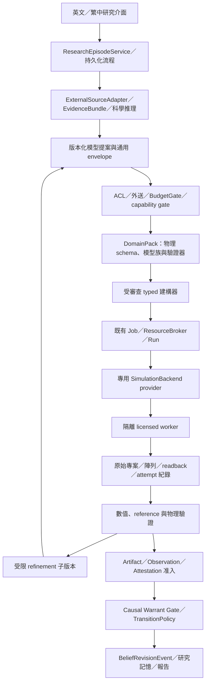

# SAI 3.4 Candidate — 架構契約與里程碑

版本：`3.4.0-candidate.2`。候選修正，尚無新 runtime；`READY_FOR_REAL_RESEARCH = false`。
本文件細化 [主規格](../spec/SAI_3.4_Candidate.md) 的 ASM-001–018，不啟用新權限。

## 1. 分層與重用



| 所屬 | 可持有 | 禁止直接持有 |
|---|---|---|
| core | 不透明 schema/policy/provider refs、project scope、immutable lineage、事件與授權 | CHARGE 欄位、網格物理意義、材料常數、Ansys SDK |
| cognition | 問題、rival、型別化 spec/patch 提案、合規 EvidenceBundle | evaluator 答案、worker shell、原始 vendor 執行介面 |
| orchestration | 檢查點、Job、ReviewItem、資源/預算/取消與續跑 | solver import、直接變更 belief、代替人簽章 |
| DomainPack | 物理 payload、units/conditions comparator、模型族、validators、observable metrics、BenchmarkPolicy | 改 core epistemic semantics、把自己輸出視為獨立證據 |
| provider/worker | 固定 typed lowering、vendor session、readback、solver execution、環境資格化 | 自定科學門檻、任意 model code、跨 project cache/憑證 |
| evaluator | sealed split、獨立 reference、凍結 scorer 與結果 | 寫 builder 的參數/提示、接受 builder 更改 oracle |

先重用 `tools/simulation.py`、`tools/execution.py`、`tools/resources.py`、
`BudgetedToolDispatcher`、現有研究服務與 `core/warrant.py`。不新增第二套 queue、budget ledger、
belief store、ReviewQueue 或 Agent 開發控制面。初期同一部署可跑流程與佇列；需要 license 的
worker 因安裝/權限邊界獨立。其餘服務拆分依量測負載，沒有先行微服務要求。

## 2. 每階段 I/O 與恢復

以下為研究子流程標籤，**不是替換既有 Episode/Job enum**。未來 adapter 將其映射至既有狀態；
任何新增 enum 另需 ADR/schema migration。狀態推進只接納提交完成且 hash 相符的輸出。

| 子流程 | 輸入 → durable 輸出 | 失敗與恢復 |
|---|---|---|
| QUESTION_FROZEN | 問題/資料分級/actor → ResearchGoal、候選假說、授權快照 | 分級不明或 actor 無權即拒絕，無外送 |
| REFERENCES_READY | public-safe query/授權來源 → ReferenceRecords、SourceWork/family | 權利未知則隔離；來源不可用保留搜尋覆蓋缺口 |
| SPEC_READY | 條件/rival/權威參數 → PhysicalModelSpec、policy refs | 科學歧義/缺參數 → ReviewItem；不猜值 |
| BUILD_READY | spec/hash、預算與 capability → BuildManifest、readback、新專案 | preflight/readback 失敗保留診斷；有限次重新建構 |
| PLAN_FROZEN | 假說、observables、build → VerificationPlan、split/protocol hashes | 缺 reference 可做開發檢查，但獨立驗收 BLOCKED |
| WAITING_RESOURCE | Job/需求/預算 reservation → durable queue/lease | 無 seat 可等待/取消；到期重新查權限與預算 |
| EXECUTING | spec/build/environment/lease → 每次 attempt 紀錄、Run、原始輸出 | process 失聯先對帳；取消與晚到 callback 不得復活工作 |
| VALIDATING | 原始資料/凍結 protocol → 六層結果、ValidationReports | 可獨立重跑 extractor/validator，不必重花 license |
| REFINING | 未通過開發目標/剩餘預算 → ModelPatch、新 spec lineage | 超出假設/權威範圍 → ReviewItem；holdout 失敗不能驅動此步 |
| ADMISSION | Run/validity/條件/授權 → Observation、Attestation、准入決定 | 任一綁定不成立拒絕；保留 raw、不得 promote |
| BELIEF_REVIEW | relation+rival+warrant → durable Decision/event 或 review | 缺可驗證 warrant 時保持未定；不能用報告文字繞過 |
| REPORTED | 每層證據/狀態/成本 → 雙語可讀與結構化 report | 完成流程與完成科學驗收分開，缺口保持可見 |

每個輸出綁定 `project_id/episode_id/trace_id/content_hash/schema_ref/producer_ref`。
spec、patch 與 validation envelope 為 **SPECIFIED**；表中既有 Job/Run 元件沒有因此變成新功能已實作。

## 3. 建構與 provider 協定

候選的私有協定（不是現有公開工具，也不是已實作 API）：

```text
validate_spec(spec_ref, capability_ref, policy_ref) -> ValidationReport
lower(spec_ref, constructor_ref) -> TypedOperationPlan
construct(operation_plan_ref, job_binding) -> BuildManifest
inspect_built_model(build_ref) -> ModelReadback
compare_readback(spec_ref, readback_ref, tolerance_policy_ref) -> ValidationReport
execute(SimulationRequest) -> BackendExecution          [沿用既有 seam]
validate(run_ref, protocol_ref) -> ValidationReport[]
propose_patch(parent_ref, development_findings_ref) -> ModelPatch
```

固定 operation 集合使用 region/material/contact/doping/solver/mesh/monitor 結構化資料。
私有 `construct` 不導出為第五種 DomainPack 工具動詞。公開 workflow 若需要新增 `run_*`，
先分配正式 `DOM-SP-TOOL-*`、定 request/result、Job/Run 語意與 tests；本候選不預占歷史 ID。

BuildManifest 是建構紀錄；Run 是 backend 執行紀錄。模擬前已建立但沒有執行的專案不產生
偽裝的「solver success」。未來多產品鏈保留每一子 Run、轉換 artifact、單位/座標映射、
父輸入 hash 與 coupling 收斂；不以最後一個 solver 的 exit code 蓋掉上游失敗。

## 4. 資格化與安全威脅

| 威脅/故障 | 設計與可否證檢查 |
|---|---|
| 範例藏 instruction 或 script | 當不可信資料解析；惡意 fixture 不得啟動 process/network，紀錄拒絕原因 |
| patch 改掉物理假設以通過測試 | 欄位規則分類、parent hash、policy 範圍；越界 patch 在任何副作用前被拒 |
| provider 自稱 licensed 或 converged | worker capability 資格化＋真實 checkout/solver log/readback；無權授權提高 authority |
| 雙 worker/晚到回覆 | lease fencing、attempt identity、只接納一次；記錄可能多次外部執行及全部費用 |
| 共享 session/cache 洩漏 | project workspace/credential/occurrence scope；跨 project、撤銷存取與 session 污染反例 |
| 過期材料庫或 solver 版本漂移 | pinned dependency 與版本矩陣；不相容即 BLOCKED，不回填舊 Run |
| evaluator 洩漏 | 不同權限/程序、holdout 存取稽核、家族 DAG、污染探測；有洩漏的集合取消獨立資格 |
| report 偷升結論 | 結論由 canonical event/warrant 狀態投影；雙語、匯出、續跑走相同授權 |

OS、SDK、design environment/solver/HPC entitlement 組合逐一資格化。
不能承諾所有 solver 可無 GUI/headless；在站點實機資格化前保持 **REQUIRES_LICENSE**。
官方文件只能指導整合，不能代替實際安裝、license 合約或器件驗證。

## 5. 候選路線圖

這是新增產品目標的候選 gate 序列，**不改 `docs/milestones.yaml` 的 M0a–M8 狀態**。
不提供未量測的工期。每個階段完成仍需維護者接受證據，不能自己簽 DONE。

C34-A0 是離線開發的限範圍架構核准，不是全面啟用 SAI 3.4。核准紀錄明列決策/ADR 版本、
核准 actor/時間、允許 slice、資料/權限/副作用邊界與排除項；未取得明確核准的 slice 不開始。
license、物理 benchmark 與 deployment/readiness 決策移至對應 gate，並非默認批准或撤銷。
ADMIN/MEMBER 是僅有的人類帳號角色；project membership、獨立 reviewer 授權與 worker
service identity 分屬不同治理範圍，不能互推權限；A3/A9/A12 未決行為不在離線授權範圍內。

| ID | 目標/需求 | 相依與 exit evidence | 目前狀態 |
|---|---|---|---|
| C34-A0 | 限範圍離線架構核准；ASM-014、018 | 明確核准 D-01 的架構/slice、D-03 既有 CWG 邊界、D-05 所用 fixture 權利與 D-06 無副作用邊界；active 3.3/鎖定仍有效；不要求 D-02/D-04/D-08 全部結案 | SPECIFIED；核准尚未提供；不啟用 3.4 |
| C34-A1 | 首次 CHARGE 建構的離線契約；ASM-002–005、007、012、016、017 | A0；empty workspace、typed schema/lowering、readback double、惡意輸入、隔離/復原/報告；不碰 license | SPECIFIED |
| C34-A2 | 授權前軟體資格與獨立 G0 研究驗收；ASM-001、002、006、008–016、018 的適用範圍 | A1；fake SDK/故障注入/ToyDomain 等明示 synthetic；另以已授權真實 LLM＋認證產品流程過 G0，涵蓋科學雙語內容/匯出及未執行模擬；只需相應來源/egress/budget/審查授權，不等待 license/物理精度/部署決策 | SPECIFIED；G0 未執行，不能用 mock 代替 |
| C34-A3 | 真實 CHARGE 首次建構與 TST-001 replay | A2＋D-04 站點 entitlement/worker、D-05 實際材料權利、D-06 執行邊界及 D-02 本階段數值協定；G1–G3、G7-SITE、G8 的 licensed 部分；保留原 TST-001 案例 | REQUIRES_LICENSE；未執行；無第二 worker 不阻擋單站 |
| C34-A4 | CHARGE 單站獨立物理/自主產品驗收 | A3＋D-02 獨立 holdout/物理門檻、D-03 適用 warrant、D-08 用途/最終接受；G4–G6、G9 與 G7-SITE，專家比較及失敗案例；部署另需明確授權 | REQUIRES_LICENSE；亦缺核准 holdout；不自稱跨 worker/站點 |
| C34-A5 | MODE → FDTD → INTERCONNECT → 多物理與移植資格 | A4；各 solver 重過適用 G1–G9/coupling，G0 的 provider/內容變更則重驗適用部分；G7-WORKER/跨站在聲稱該範圍前另有目標環境資格與重播；與 M6 對齊而不替它簽核 | DEFERRED；不回頭阻擋合格的單站驗收 |

可在取得 license 前完成 A1/A2 的設計、schema、確定性 compiler、fake worker、oracle isolation、
fault injection 與封包驗證；A2 的 G0 另需真實受治理 LLM，不能把整個 A2 標成 synthetic。
這不包含 A3/A4。MODE/FDTD/INTERCONNECT 各有獨立資格與 budgets；
一個產品的通過不轉移到另一個。第二 DomainPack 的 removable-plugin 測試在 A2 先驗證核心通用性。
