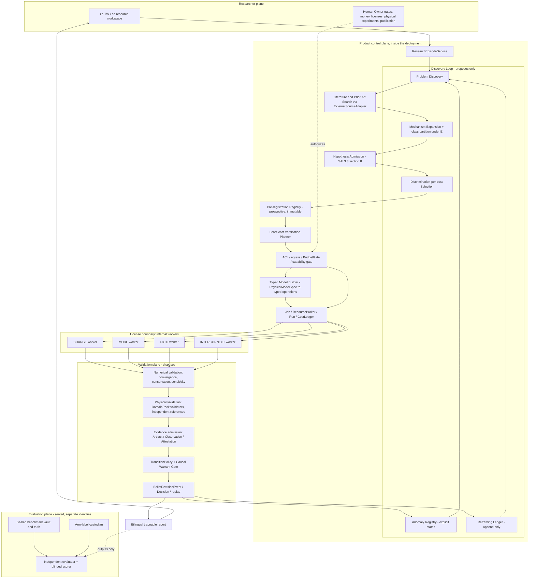

# SAI 3.5 Discovery Candidate — End-to-end architecture

Version: `3.5.0-discovery-candidate.1`. Refines §2–§5 of the
[candidate](../SAI_3.5_Discovery_Candidate.md) and builds on the SAI 3.4
[architecture contract](../../architecture/sai34-autonomous-modeling.md), which is unchanged.
Status: **CANDIDATE — NOT ACTIVE.** This is a target design. Most components do not exist; see
[implementation status](implementation-status.md).

## 1. Components

No arrow leads from the evaluation plane into the control plane or the Discovery Loop. The
evaluator reads outputs; nothing it holds flows back.

## 2. Responsibilities and prohibitions

| Component | Holds | Must not hold or do |
|---|---|---|
| Discovery Loop | problems, anomaly states, mechanism class partitions, reframing records, selection decisions | write belief states or validation verdicts; read sealed truth; change validators, protocols or tolerances (D-023) |
| Literature search | pinned passages, licenses, PriorArtSearchRecords | send non-PUBLIC queries; treat a fixture corpus as live search (D-007) |
| Pre-registration Registry | immutable registrations dated by the database clock, with the authorizing human | edit a registration in place (D-024) |
| Model Builder | typed operations, BuildManifest, readback | run model-generated code; reuse a hidden prebuilt project (D-008) |
| Internal workers | a vendor session per job, checkout records, raw outputs | network beyond the allowlisted license endpoint; cross-project caches; any coding agent (D-006, D-009) |
| Validation plane | numerical and physical validation reports, admission, warrants | accept a discovery-side verdict; confirm outside the Causal Warrant Gate (D-026) |
| Evaluation plane | sealed benchmark, truth, arm-label key, scorer | send anything to the control plane; be operated by the implementer (D-035, D-040) |

## 3. Data flow of one campaign

1. A researcher opens an episode or an anomaly is flagged. Problem Discovery creates a
   ResearchProblem with its origin and links (D-015). Non-zero-cost work waits for a human member to
   accept the problem.
2. Literature and prior-art search runs only on a query declared PUBLIC, through authorized
   adapters, and records its coverage (D-007, D-004).
3. Mechanism Expansion proposes hypotheses. Admission (SAI 3.3 §8) admits those with mechanism,
   typed predictions, falsifier, assumptions and minimum test. The class partition is computed under
   the current experiment set *E* (D-016, D-017).
4. Discrimination-per-cost Selection proposes the next experiments (D-021). An experiment needing
   money, a license, a physical experiment or publication goes to the Owner gate (D-030).
5. Each chosen test is pre-registered before its data exists (D-024).
6. If a simulation is needed, the Model Builder lowers a PhysicalModelSpec into typed operations;
   a Job reserves budget and a license seat; an internal worker builds, reads back and solves
   (D-008, D-009). Sweeps run as pre-registered plans (D-010).
7. Numerical validation runs the convergence study before any simulated observable may discriminate
   (D-011). Physical validation uses independent references (D-013).
8. Evidence admission records Observations and Attestations. TransitionPolicy decides belief moves;
   only the Causal Warrant Gate confirms (D-026). Evidence that fails the prospective rules is
   recorded as CITES (D-025).
9. Anomaly states and the class partition update. Failed or inconclusive hypotheses can trigger
   Research Reframing, which appends a record and starts a new lineage (D-019, D-020).
10. The campaign ends on success, on INSUFFICIENT_VALIDATION or on STOPPED (D-022, D-028). The
    bilingual report lists every state, failure, stop reason and cost (D-014).

## 4. Trust boundaries

| ID | Boundary | Crossing rule | Current limit |
|---|---|---|---|
| TB-1 | researcher ↔ product | authenticated session, project membership and clearance on every request | session and account controls exist on this line; A3/A9/A12 stay open |
| TB-2 | product ↔ model and literature providers | egress gate by sensitivity, project declaration and budget; typed outputs only | spend administration and the free-endpoint declaration exist only on the G0 line (`58c68be`, `011t`) |
| TB-3 | control plane ↔ internal workers (license boundary) | Job binding, fencing token, typed operations only, recorded checkout | no worker exists; the Lumerical provider is a mock |
| TB-4 | everything ↔ evaluation plane | outputs flow out to the evaluator; nothing flows back; separate identities | not built for G-D; G0 tooling exists only on the G0 line |
| TB-5 | application ↔ database authority | database triggers hold rules for normal writers | a superuser or migrator can bypass triggers (A12); on the G0 line `011u` detects account changes but does not prevent them |
| TB-6 | development plane ↔ production | coding agents and developer sessions exist only in development; no runtime path | not yet tested by a deployment-equivalent check (T-D-006) |

## 5. Internal Lumerical workers

The design follows ASM-005, ASM-006, ASM-007 and the SAI 3.4 architecture §3–§4, unchanged. In
summary:

- **Ownership.** Workers run inside the deployment under a non-human worker service identity. They
  are never operated by a developer or a coding agent.
- **Products.** CHARGE, MODE, FDTD and INTERCONNECT are separate capabilities, each qualified on
  its own: install, SDK compatibility, design-environment license, solve and HPC entitlements, OS
  and version matrix. One product's qualification does not transfer to another.
- **Isolation.** Non-administrator account, a per-job workspace root, path normalization and
  symlink-escape refusal, read-only inputs, memory and output limits, a process allowlist, no
  network except the allowlisted license endpoint, hash-pinned packages and templates, and a clean
  session per job.
- **Execution.** Only typed operations from the Model Builder are accepted. Readback is compared
  independently with the spec. Every attempt records start and end, exit status, logs, output
  arrays and the actual license checkout and release.
- **Governance.** A run needs a Job with reserved budget and a valid Owner license authorization
  for the campaign. Heartbeats, fencing tokens and timeouts apply; a stale worker cannot write
  back. An outcome that cannot be determined is UNKNOWN and is reconciled before any retry.
- **Today.** None of this exists. `src/lab_brain/tool_providers/lumerical/` contains a
  deterministic mock only, and `tests/e2e/test_vs_sp_001_licensed_replay.py` fails by design when
  the licensed gate is enabled because no licensed provider exists.

## 6. Reuse before new parts

Discovery reuses the existing research service, structured debate, admission gate, least-cost
planner, Job/Run/budget seams, evidence admission, TransitionPolicy and the Causal Warrant Gate. It
does not add a second queue, budget ledger, belief store, ReviewQueue or development-agent control
plane. New persistent records (ResearchProblem, AnomalyState, MechanismClassPartition, Reframing,
PreRegistration where not already present) would need their own ADR, schema migration and tests in
a later, separately approved slice.
