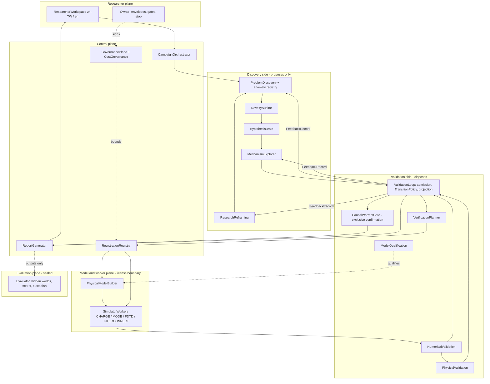

# SAI 3.5 — Appendix B: Architecture, components and responsibility boundaries

Version: `3.5.0-master-candidate.3`. Status: **CANDIDATE — NOT ACTIVE.** `READY_FOR_REAL_RESEARCH = false`.
Authority: normative for component responsibilities, prohibitions and trust boundaries; refines
[SAI 3.5](../SAI_3.5.md) §3 and builds on the unchanged SAI 3.4
[architecture contract](../../architecture/sai34-autonomous-modeling.md). This is a target design;
most components do not exist ([implementation status](implementation-status.md)).
Supersedes the `3.5.0-discovery-candidate.1` version of this file (kept in git history).

## 1. Planes

| Plane | Contains | Crosses to |
|---|---|---|
| Researcher plane | ResearcherWorkspace, Owner and member decisions | control plane through authenticated sessions (TB-1) |
| Control plane | CampaignOrchestrator, GovernancePlane, CostGovernance, RegistrationRegistry, ReportGenerator | every other plane |
| Discovery side | DiscoveryLoop: ProblemDiscovery, HypothesisBrain, MechanismExplorer, ResearchReframing; NoveltyAuditor (search and classification only) | proposes to the validation side; reads feedback records only |
| Validation side | VerificationPlanner, ValidationLoop, NumericalValidation, PhysicalValidation, ModelQualification, CausalWarrantGate | writes verdicts, belief events and confirmations; never generates the hypotheses it validates |
| Model and worker plane | PhysicalModelBuilder, SimulatorWorkers | license boundary (TB-3); raw outputs only |
| Evaluation plane | EvaluationPlane (sealed vault, hidden-world generator, independent evaluator, scorer, arm-label custodian) | reads outputs; nothing flows back (TB-4) |
| Development plane | developers and coding agents, CI | never reaches production at run time (TB-6) |

## 2. Components

Each component runs under its own service identity with the least privilege of the permission
matrix ([governance-security.md](governance-security.md) §5). "Reuses" names existing code on the
SAI 3.4 integration line (`a38ad63`) unless another commit is given.

| Component | Responsibility | Holds or produces | Must not | Reuses | Requirements |
|---|---|---|---|---|---|
| CampaignOrchestrator | runs the lifecycle stages and the campaign state machine; checkpoints and restart; termination | ResearchCampaign, stage checkpoints, StopRecord | set episode or belief states; widen an envelope; call a coding agent | `research/service.py`, `tools/execution.py` | S35-LIFE-001–003, S35-GOV-003, S35-AUTO-003 |
| ProblemDiscovery | detects anomalies, contradictions and knowledge gaps; creates and values ResearchProblems; keeps the anomaly registry | ResearchProblem, ProblemValuation, Anomaly and its state events | send non-PUBLIC material out; consume more than the zero-cost tier outside an envelope or acceptance | `core/models/conflict.py` (Conflicts) | S35-PROB-001–004 |
| HypothesisBrain | generates exploratory ideas and candidate mechanisms through ScientificLLM and ModelRouter; submits ideas with typed predictions to admission | ExploratoryIdea with InferenceProvenance | set any state; count as evidence; read sealed material | `cognition/debate.py`, `llm_runtime/runtime.py` | S35-HYP-002, S35-HYP-004 |
| MechanismExplorer | computes mechanism identities, pair verdicts and certified diversity bounds under the experiment set (Appendix S); tests every held mechanism for adequacy; expands the search space after failure, residuals or inadequacy | DistinguishabilityGraph, AdequacyAssessment, ExperimentSet version, expansion records | count hypotheses as diversity; merge pairs transitively; resolve unresolved pairs by fiat; endorse an inadequate mechanism | offline prototype `118a4ac:src/lab_brain/discovery/distinguish.py` (computes connected components, a transitive merge that candidate.2 forbids) | S35-MECH-001, S35-MECH-002 |
| ResearchReframing | creates typed, append-only Reframings when assumptions, observables, models or hypotheses fail | Reframing | edit or hide failure history; turn failure into support | offline prototype `118a4ac:src/lab_brain/discovery/loop.py` | S35-REF-001–003 |
| DiscoveryLoop | the Discovery side as a whole: proposes problems, ideas, mechanisms, reframings and candidate experiments; hands claims over to validation | hand-over packets, always pending the Causal Warrant Gate | write verdicts, belief states or confirmations; change validators, protocols, tolerances or scoring; read sealed material | offline prototype `118a4ac:src/lab_brain/discovery/handover.py` | S35-HYP-001, S35-LOOP-001 |
| NoveltyAuditor | runs authorized literature and prior-art search; assigns novelty classes bounded by coverage | PriorArtSearchRecord, NoveltyAssessment | present internal novelty as global; assert new physical knowledge before stage 3 and physical validation | `cognition/novelty.py`, `research/literature.py` | S35-NOV-001–003 |
| VerificationPlanner | selects discriminating experiments per unit cost with SAI 3.3 §9 sufficiency and a deterministic SelectionPolicy | SelectionDecision | use uncalibrated expected information gain; dispatch a gated experiment before its authorization | `verification/least_cost.py`, `verification/sufficiency.py` | S35-SEL-001 |
| RegistrationRegistry | creates immutable prospective Registrations, automatically inside an envelope or under a signed human authorization; stores envelopes and their revocations | Registration, ResearchEnvelope, EnvelopeRevocation | edit a registration; accept a client timestamp; let an envelope authorize a conclusion | `f41758c:src/lab_brain/verification/prospective.py` | S35-REG-001–003 |
| PhysicalModelBuilder | lowers a PhysicalModelSpec into the closed typed operation catalog; builds from scratch; reads back; applies bounded ModelPatches | typed operation plan, BuildManifest, ModelReadback, child spec versions | run generated code; reuse a hidden prebuilt project; fill unknowns with defaults | none (SAI 3.4 SPECIFIED) | S35-MOD-001, S35-MOD-002, S35-VAL-004 |
| ModelQualification | qualifies model families and each licensed product per worker | qualification records with scope | transfer one product's or worker's qualification to another | none | S35-MOD-003, S35-SIM-002 |
| SimulatorWorkers | run CHARGE, MODE, FDTD and INTERCONNECT on internal qualified workers under Job, registration, fencing and reservation | Runs, raw artifacts, readback, attempt and checkout records | return verdicts; reach the network beyond the license endpoint; share caches across projects; be operated by a coding agent | `tools/simulation.py`, `tools/execution.py`; today only `tool_providers/lumerical/mock.py` | S35-SIM-001, S35-SIM-003 |
| NumericalValidation | registered sweeps, convergence studies, per-source uncertainty | sweep plans and results, convergence records, uncertainty records | let an unconverged observable discriminate | `domains/silicon_photonics/validators.py` (trend rules only) | S35-VAL-001–003 |
| PhysicalValidation | validation against independent references with uncertainty | validation reports, split manifest checks | accept simulation agreement or trend as physical validation | none | S35-VAL-005 |
| ValidationLoop | evaluates competing explanations independently, admits evidence, runs TransitionPolicy, projects claim states, emits FeedbackRecords and StopRecords | Attestations, RelationJudgments, BeliefRevisionEvents, claim-state projection, FeedbackRecord, StopRecord | generate the hypotheses it validates; write CONFIRMED | `research/service.py`, `core/hypothesis_admission.py` | S35-SEL-002, S35-HYP-003, S35-LOOP-002, S35-LOOP-003, S35-EVI-001, S35-EVI-003, S35-REG-004 |
| CausalWarrantGate | the exclusive confirmation authority (V1.1, unchanged) | warrant decisions, signed reviews, CONFIRMED | be bypassed, widened (DISCRIMINATION, multi-cause) or replaced by automation | `core/warrant.py`, `security/reviewer_identity.py`, `research/confirmation.py` | S35-CWG-001, S35-CWG-002 |
| ReportGenerator | bilingual traceable reports, reproducible bundles, glossary terms | Report, ReportBundle | translate over a canonical record; show an unpassed step as verified | `research/report.py`, `research/render.py` | S35-RPT-001–003, S35-VAL-003 |
| ResearcherWorkspace | bilingual researcher UX: campaigns, stages, anomalies, authorizations, budgets, envelope, stops | ReviewItem resolutions | collect consent by timeout; hide UNKNOWN or NOT_PERFORMED | `interfaces/web/i18n.py` and the web workspace | S35-RPT-004 |
| GovernancePlane | identities, ACL, egress, Owner gates, autonomy levels, permission matrix, provenance rules, Owner stop | authorizations, revocations, audit events | sign for the Owner; treat a timeout as consent | `accounts/service.py`, `security/egress.py`, `core/review_queue.py` | S35-SEC-001–006, S35-EVI-002 |
| CostGovernance | reservations before side effects, realized consumption, ceilings | CostLedger entries, reconciliation | presume an endpoint free; raise a ceiling without the Owner | `core/budget.py`; `f41758c:migrations/011v_llm_spend_local_is_not_free.sql` | S35-COST-001, S35-COST-002 |
| EvaluationPlane | independent G-D evaluation: sealed vault, hidden-world generator, evaluator, blinded scorer, arm-label custodian; contamination defenses | frozen protocols, sealed benchmarks, verdicts | send anything to the control plane; be operated by the implementer | `f41758c:src/lab_brain/evaluation/` (G0 tooling) | S35-GD-001–003, S35-CMP-001–009, S35-EVI-004 |
| DeploymentOperations | release images, egress allowlists, the no-coding-agent audits | release inventory and audit reports | ship a coding-agent binary, credential or route; give research services write access to code | `deployment/` | S35-AUTO-001, S35-AUTO-002 |
| SpecMaintenance | this specification, its registry and checkers, spec issues | checker results, spec issues | resolve a conflict by preference; activate SAI 3.5 | `docs/spec/sai35/check_candidate.py` | S35-GOV-001, S35-GOV-002, S35-GOV-004, S35-GOV-005 |

## 3. Data flow

No arrow leads from the evaluation plane into any other plane. The Discovery side reads validation
results only through FeedbackRecords (S35-LOOP-002).

## 4. Trust boundaries

| ID | Boundary | Crossing rule | Current limit |
|---|---|---|---|
| TB-1 | researcher ↔ product | authenticated session, project membership and clearance on every request | accounts exist on the integration line; A3, A9 and A12 open |
| TB-2 | product ↔ model and literature providers | egress by sensitivity, project declaration and budget; typed outputs only; no endpoint presumed free | local-endpoint metering (`011v`) exists only on the unintegrated G0 line |
| TB-3 | control plane ↔ workers (license boundary) | Job, registration id, fencing token, typed operations, recorded checkout | no worker exists; the Lumerical provider is a mock |
| TB-4 | everything ↔ evaluation plane | outputs flow out; nothing flows back; separate identities | G0 evaluation tooling only, on the G0 line |
| TB-5 | application ↔ database authority | database rules hold the permission matrix for normal writers | a superuser or migrator can bypass rules (A12); `011u` on the G0 line detects account changes but does not prevent them |
| TB-6 | development plane ↔ production | no coding agent, developer session or credential in production | not tested (S35-AUTO-001, S35-AUTO-002) |
| TB-7 | Discovery side ↔ Validation side | proposals and hand-overs only; FeedbackRecords back; separate identities | not built; the offline prototype hands over a pending packet |

## 5. Internal Lumerical workers

Unchanged from SAI 3.4 ASM-005, ASM-006 and ASM-007 and the SAI 3.4 architecture §3–§4: workers run
inside the deployment under a non-human worker service identity; each product (CHARGE, MODE, FDTD,
INTERCONNECT) is qualified separately; isolation is per job (non-administrator account, workspace
root, path normalization and symlink-escape refusal, read-only inputs, resource limits, process
allowlist, network only to the allowlisted license endpoint, hash-pinned packages and templates,
clean session); only typed operations are accepted; readback is compared independently; every
attempt records its checkout and release; heartbeats, fencing and timeouts apply; an undeterminable
outcome is UNKNOWN and is reconciled before any retry. SAI 3.5 adds only the registration binding
and the raw-outputs-only rule of S35-SIM-003. Today none of this exists.

## 6. Reuse before new parts

The product reuses the research service, structured debate, the §8 admission gate, the least-cost
planner, Job/Run/budget seams, evidence admission, TransitionPolicy, ReviewQueue and the Causal
Warrant Gate. It adds no second queue, budget ledger, belief store, ReviewQueue or development-agent
control plane. New persistent records ([records-and-states.md](records-and-states.md)) each need an
ADR, a schema migration and tests in a separately approved slice; the offline prototype on
`118a4ac` is input to that work, not a substitute for it.
